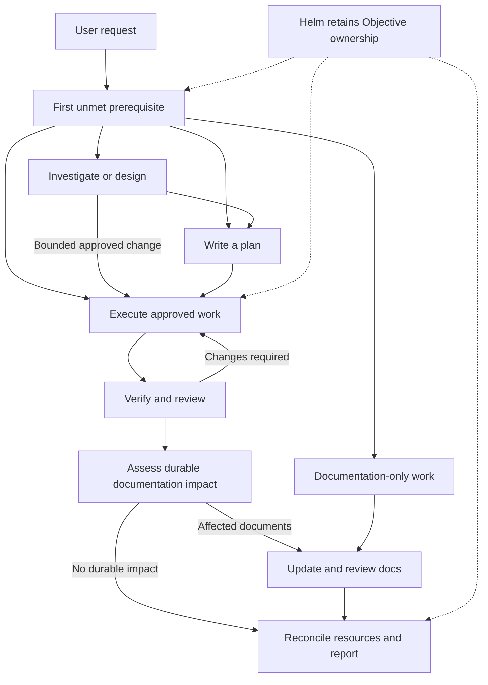
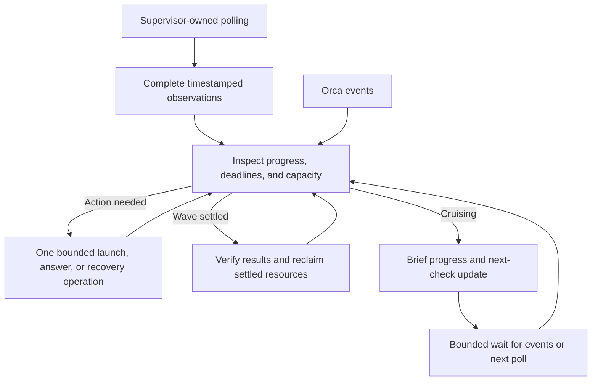

# Superca

A development lifecycle, living project documentation, and supervised agent
execution—working together through Orca.

Superca combines the **Superpowers-derived development lifecycle**, a
**DryForge-shaped documentation system**, and **Orca-powered execution** into
one plugin. Start with an idea, a bug, an approved plan, or an existing codebase.
Use individual skills for focused work, or ask **Helm** to own an objective
through verification and handoff.

Superca is a collection of agent instructions, not a background service.
It uses standard APM packaging, with lifecycle guidance for Claude Code and Codex.
Use the installed Orca and agent-host capabilities on your operating system;
no particular model, provider endpoint, shell, or local profile layout is required.

## Contents

- [Getting started](#getting-started)
- [How the lifecycle works](#how-the-lifecycle-works)
- [Choose your entry point](#choose-your-entry-point)
- [Skill guide](#skill-guide)
- [Supervision and recovery](#supervision-and-recovery)
- [Decisions and human authority](#decisions-and-human-authority)
- [Project structure and documentation](#project-structure-and-documentation)
- [State and resuming work](#state-and-resuming-work)
- [Limits and troubleshooting](#limits-and-troubleshooting)
- [Development and attribution](#development-and-attribution)

## Getting started

### Install from the repository

Use a supported agent host and an available Orca CLI and runtime for mutation
workflows. Read-only investigation can remain local; work that changes code,
documentation, or lifecycle state must bind to Orca.

The [goodies marketplace](https://github.com/oognuyh/goodies) provides Superca
as the `superca` plugin. Once the repository's marketplace distribution is
published on `main`, install it through your host:

```sh
# Claude Code
claude plugin marketplace add oognuyh/goodies
claude plugin install superca@goodies

# Codex (alternative to Claude Code)
codex plugin marketplace add oognuyh/goodies
codex plugin add superca@goodies
```

The `main` branch must contain both marketplace indexes
(`.claude-plugin/marketplace.json` and `.agents/plugins/marketplace.json`) and
their referenced bundle (`build/marketplace/plugins/superca`).
[Branch CI](../../.github/workflows/ci.yml) builds and commits these generated
files on pushes to `main` and `develop`; wait for its distribution-sync commit
before installing from GitHub. CLI syntax has been checked, but remote
installation has **not** been tested end to end. In Codex, start a new session
after installation so the plugin can be discovered. Skill invocation syntax
varies by host.

This directory is the APM source package, not a generated host plugin. For an
APM project installation, use this source package as the dependency, not the
generated host bundle. With the pinned APM 0.29.0, installing the bundle as an
APM dependency copies its payload but does not perform the source route's Claude
hook registration or Codex reviewer-role conversion. The generated bundle is
for native host plugin installation.
APM project installs register bare skill names such as `helm` and
`decision-council`; use the selector shown by your host rather than assuming a
`superca:` prefix.
For a one-off `--plugin-dir` test, give Orca-launched worker agents the same
plugin path; a root-only plugin flag is not inherited by new agent terminals.

Before execution, the agent checks the installed Orca interface:

```sh
orca status --json
```

For commands it needs, the agent selects the relevant entries from
`orca agent-context --json` or checks that verb's `--help`.

### Give it an objective—or invoke one skill

These are natural-language prompts, not shell commands:

```text
Use helm to add CSV export to this project. Preserve the existing API,
verify the behavior, and update any affected project documentation.
```

```text
Use writing-plans to turn this approved design into an implementation plan.
```

```text
Use executing-plans to execute the approved plan at <plan-path>.
```

```text
Use maintaining-project-docs to bootstrap documentation for this existing
codebase from repository evidence. Do not change application code.
```

Provide the desired outcome, constraints, and existing evidence or document
paths. A ticket is optional. Existing approved designs and plans are reused.

## How the lifecycle works

Start at the first unmet prerequisite. Not every request needs a new design,
a multi-step plan, parallel workers, or an ADR.



Testing and review happen during implementation, not only at its end. A material
decision may also require an accepted, reviewed ADR **before** dependent work
proceeds. Helm Objective completion requires fresh evidence, reviewed
documentation impact, and reconciled execution resources—not merely a worker
saying it is done. A standalone skill stops at its requested stage boundary.

Code review runs in a fresh Orca worker. Where the host exposes the packaged
`superca-code-reviewer` agent, that worker gives it the bounded review brief in
a separate context and relays the verdict; otherwise the fresh worker reviews
the same brief directly. The named agent does not replace Orca supervision.

With the pinned APM 0.29.0, source project installs convert the reviewer to
`.codex/agents/superca-code-reviewer.toml`. Installing this repository's generated
Claude-plugin bundle preserves `.agent.md` instead. A deployed file alone does
not prove host discovery, role invocation, or the model used; verify those at
runtime and retain the fresh-worker fallback.

### Helm versus standalone skills

| Responsibility | Standalone execution | Helm |
| --- | --- | --- |
| Supervise workers, capacity, and recovery | Yes, within the requested plan | Yes, throughout the objective |
| Verify the requested work | Yes | Yes |
| Select and continue across lifecycle skills | Within the requested scope only | Yes |
| Own objective fit, replanning, and documentation continuity | Not implicitly | Yes |
| Override human-owned decisions | No | No |

Helm runs in the active root session. Being the first session does not activate
it automatically. Workers own assigned Tasks; they do not become supervisors
or recursively launch other workers.

## Choose your entry point

| Your situation | Start with |
| --- | --- |
| Complete an objective end to end | `helm` |
| Explore a new or changed behavior | `brainstorming` |
| Turn a design into executable steps | `writing-plans` |
| Execute an approved plan | `executing-plans` |
| Execute through supervised implementation and review workers | `subagent-driven-development` |
| Investigate a bug or failing test | `systematic-debugging` |
| Establish or update project knowledge | `maintaining-project-docs` |
| Diagnose a problematic Superca session | `diagnosing-superca` |

## Skill guide

Each skill name links to its full instructions. The descriptions below explain
selection and usage; the linked skill and shared references define the details.

### Entry and supervision

| Skill | When | How | Why / outcome |
| --- | --- | --- | --- |
| [using-superca](.apm/skills/using-superca/SKILL.md) | Starting a root conversation | Load the routing instructions and relevant host references | Discover applicable skills and establish execution boundaries |
| [helm](.apm/skills/helm/SKILL.md) | Delegating an objective end to end | Provide outcome, scope, constraints, and completion evidence | Keep one supervisor responsible across skill transitions, recovery, and documentation |

### Discovery and planning

| Skill | When | How | Why / outcome |
| --- | --- | --- | --- |
| [brainstorming](.apm/skills/brainstorming/SKILL.md) | Introducing or changing behavior | Supply intent and constraints; examine repository evidence and alternatives | Establish an approved design proportionate to the change |
| [writing-plans](.apm/skills/writing-plans/SKILL.md) | Approved requirements need a multi-step implementation | Supply the design; define steps, ownership, dependencies, resource expectations, and verification | Produce an executable plan with clear supervision inputs |

### Execution and isolation

| Skill | When | How | Why / outcome |
| --- | --- | --- | --- |
| [executing-plans](.apm/skills/executing-plans/SKILL.md) | An approved plan is ready | Provide its path; recover or bind an Orca Run and execute dependency-valid Tasks | Complete the plan under continuous supervision; tightly coupled work may stay with the root |
| [subagent-driven-development](.apm/skills/subagent-driven-development/SKILL.md) | Worker execution and review Tasks are warranted | Give workers scoped Task packets and verify their results in the same Run | Delegate implementation without losing root ownership or review obligations |
| [dispatching-parallel-agents](.apm/skills/dispatching-parallel-agents/SKILL.md) | Two or more ready Tasks are genuinely independent | Check dependencies, write ownership, and measured capacity before admitting a wave | Gain safe parallelism without overcommitting resources or conflicting writes |
| [using-git-worktrees](.apm/skills/using-git-worktrees/SKILL.md) | Mutation work needs an isolated checkout | Inspect current placement and use Orca-managed worktree setup | Isolate changes while preserving explicit resource ownership |

`executing-plans` owns plan execution; `subagent-driven-development` structures
worker implementation and review; `dispatching-parallel-agents` controls a
concurrent wave. They are complementary, not three names for the same action.

### Quality and completion

| Skill | When | How | Why / outcome |
| --- | --- | --- | --- |
| [test-driven-development](.apm/skills/test-driven-development/SKILL.md) | Implementing a feature or bug fix | Demonstrate a failing test, implement the minimum fix, then refactor | Prove the test detects the behavior before relying on it |
| [systematic-debugging](.apm/skills/systematic-debugging/SKILL.md) | A bug, failure, or unexpected behavior appears | Gather evidence, investigate the cause, test a hypothesis, then fix | Resolve the cause rather than accumulating speculative patches |
| [requesting-code-review](.apm/skills/requesting-code-review/SKILL.md) | A task or change needs independent review | Provide requirements, implementation scope, diff pointers, and verification evidence | Detect specification and implementation gaps before acceptance |
| [receiving-code-review](.apm/skills/receiving-code-review/SKILL.md) | Review feedback arrives | Check each finding against evidence; clarify, fix, or explain disagreement | Incorporate justified corrections without blindly changing code |
| [verification-before-completion](.apm/skills/verification-before-completion/SKILL.md) | About to claim success | Run the relevant checks and read fresh output | Make completion claims supported by evidence |
| [finishing-a-development-branch](.apm/skills/finishing-a-development-branch/SKILL.md) | Implementation is ready for closure | Verify, reconcile reviews, assess docs, reclaim resources, and present applicable owner choices | Deliver a verified handoff without assuming permission to merge or publish |

### Documentation and maintenance

| Skill | When | How | Why / outcome |
| --- | --- | --- | --- |
| [decision-council](.apm/skills/decision-council/SKILL.md) | Consequential alternatives involve competing stakeholder interests, or a council is explicitly requested | Invoke directly or through Helm; collect independent stakeholder positions through Orca and return them to the calling root Supervisor | Reach an evidence-backed decision with reviewed ADR capture; Helm is not required |
| [maintaining-project-docs](.apm/skills/maintaining-project-docs/SKILL.md) | Bootstrapping docs, recording a material decision, or updating verified knowledge | Select `bootstrap`, `decision`, or `update`; use evidence and obtain independent documentation review | Keep durable project knowledge accurate without changing application code |
| [diagnosing-superca](.apm/skills/diagnosing-superca/SKILL.md) | A session repeats work, misses skills, stalls, or produces poor results | Provide the current session or a past session identifier/path | Build an evidence-backed diagnosis or useful maintainer bug report |

## Supervision and recovery

The root starts and owns a read-only polling session through its host's
nonblocking shell execution facility. It collects complete Task, worker, and
resource observations approximately **every 30 seconds**, including during
worker preparation and recovery. The supervisor reads those observations,
handles events, and makes decisions; the polling process does not ACK messages,
dispatch workers, or accept results. No daemon or additional tool is required.

Samples retain every current inventory and pressure row without repeating
pressure history. The root drains them promptly and fetches full changed-worker
evidence when needed; clipped output is an unmeasured interval, not coverage.



- **Admission:** ready does not mean safe to launch. Measure capacity, honor
  exclusive ownership, and probe unknown heavy workloads conservatively.
- **Waiting:** keep the root turn live while startup/recovery, workers, or
  Deliveries need supervision. Drain polling output and handle messages between
  bounded foreground waits (at most 5 seconds each). A collecting shell process
  or completion listener is not an independently acting supervisor. Report
  collection gaps separately from the root's actual interpretation/response delays.
- **Preparation:** reconcile, perform one bounded launch/recovery operation,
  then reconcile again. The required worker configuration and polling checkpoint
  precede terminal preparation; a startup procedure must not take over the loop.
- **Submission:** confirm the terminal accepted input and the agent actually
  started. A visible draft and an accepted-but-unconfirmed prompt require
  different handling; blindly pressing Enter can duplicate work.
- **Worker skills:** verify required Superca skills load in the worker before
  substantive work; `Unknown skill` means that Task did not run under Superca.
  Verify the launched worker's model and provider endpoint too; the root's
  per-process API settings are not inherited automatically.
- **Recovery:** inspect the exact Dispatch and mutation receipts, address the
  cause, and reconcile ownership before replacing a failed worker on the same
  Task. Do not silently switch execution systems and call the Orca path tested.
- **Cruising:** provide a short status update, then remain available for the
  next poll or user input. A quiet mailbox is neither failure nor completion.
- **Cleanup:** reconcile worker resources, preserve work, and stop the exact
  owned polling session. Do not close unrelated user terminals, stop all host
  execution sessions, or delete unowned worktrees.

See the [shared Orca contract](.apm/skills/using-superca/references/orca-cli.md)
for the operational rules and capability-aware recovery procedures.

## Decisions and human authority

Routine, reversible choices stay with the supervisor and repository conventions.
They do not need a meeting or an ADR merely because they were discussed.

Consequential choices with costly reversal and materially different alternatives
get an ADR, even when the supervisor can decide from evidence alone. When such a
choice also has distinct stakeholder interests, the calling root Supervisor
assembles **two to four evidence-backed stakeholder Tasks**. They provide
independent positions and, if necessary, one bounded disagreement round. The
Supervisor makes the delegated final decision; Helm fills that role when active.
Consensus is advice, not authority. The resulting ADR is independently reviewed
before dependent work relies on it.

Human-owned choices remain human-owned: destructive actions, credentials,
production changes, publication or integration, missing product or policy intent,
risk acceptance, conflicting authorities, and material scope expansion. A scoped
Gate identifies what is blocked. Independent authorized work can continue.

See [decision authority](.apm/skills/decision-council/SKILL.md).

## Project structure and documentation

Superca works with your application's existing layout. It does not require a
particular framework, a knowledge graph, or a new runtime-state directory.

The following is an **illustrative consuming project**, not the plugin's source
tree. Only create documents with applicable, durable content; this is not a
mandatory scaffold.

```text
your-project/
├── AGENTS.md                    # Canonical project instructions
├── CLAUDE.md                    # Exactly @AGENTS.md and a final newline
├── src/                         # Existing application layout; not prescribed
│   └── some-module/
│       └── AGENTS.md             # Optional materially different module rules
├── tests/                       # Existing verification layout
└── docs/
    ├── architecture.md          # Boundaries, dependencies, system structure
    ├── business-rules.md        # Domain rules and invariants
    ├── user-journeys.md         # Optional cross-step user outcomes
    ├── security.md              # Security requirements and policies
    ├── standards.md             # Development and verification conventions
    ├── engineering-notes.md     # Durable implementation knowledge
    ├── operations.md            # Operating and recovering the system
    ├── contracts.md             # External interfaces and guarantees
    ├── superca/
    │   ├── specs/               # Approved designs, when needed
    │   │   └── YYYY-MM-DD-topic-design.md
    │   └── plans/               # Implementation plans, when needed
    │       └── YYYY-MM-DD-feature-name.md
    └── tracking/
        ├── status.md            # Current scope and explicitly future work
        ├── findings.md          # Relevant findings and unresolved issues
        └── decisions/
            └── YYYY-MM-DD-decision-slug.md
```

Design specs and implementation plans are also Git artifacts. Follow the active
skill's path convention and any explicit project override; they are work inputs,
not a second execution ledger. Reuse an existing ADR filename convention when
one exists.

### Brownfield and greenfield

- **Brownfield:** inspect code, tests, existing prose, and relevant history.
  Bootstrap only the documentation the evidence supports. Old prose is evidence,
  not unquestionable authority; ask only for consequential knowledge the repo
  cannot establish.
- **Greenfield:** bootstrap the applicable document set after the first
  implementation slice is verified, before starting the next slice. Assess
  every durable document slot;
  do not describe planned features as current behavior.
- **Ongoing work:** update only documents affected by verified changes. If
  nothing durable changed, record that conclusion rather than creating filler.
- **Decisions:** record meaningful accepted decisions, alternatives, rationale,
  consequences, and risks—not every Task or a transcript of a discussion.

Documentation is part of the lifecycle, not a separate executor bolted onto its
end. Planning, execution, decision capture, and closure all carry documentation
obligations; `maintaining-project-docs` provides the shared writing and review
discipline. Its [project document format](.apm/skills/maintaining-project-docs/references/project-document-format.md)
defines what each file contains, excludes, and must prove; the example tree
above is not a set of empty templates to generate. An ADR must receive an
Approved review of its final text before dependent implementation, and fixes
after a documentation review receive a focused review of the final diff.
The same documentation Task stays open through in-scope repairs until the final
matched approval. Review reports travel as literal text, and unresolved findings
require their exact reproduction evidence—not a nearby passing example.

The Stop hook emits a user-visible reminder to assess documentation impact
before completing change work. It does not block completion, automatically
update documents, or guarantee that the host delivers the reminder to the
agent. Workers report impact within their assigned scope; the root owns the
documentation follow-through. Codex project hooks also require project-layer
trust and per-hook review before they run; verify the hook is trusted after
installation or when its definition changes.
SessionStart remains limited to the existing skill-loading reminder.

## State and resuming work

| Source of truth | What belongs there |
| --- | --- |
| Orca | Run, Task, Dispatch, Delivery, Gate, and resource ownership state |
| Git | Code, tests, approved designs, plans, durable project documents, ADRs |
| `AGENTS.md` | Canonical project instructions |
| `CLAUDE.md` | A reference to `AGENTS.md`, not a duplicate instruction set |

After interruption, recover the existing Run, plan pointer, Tasks, Dispatches,
pending questions and Gates, unconsumed Deliveries, and observation deadlines.
Confirm coordinator ownership before mutation. Do not create a second live
supervisor or repeat completed work simply because conversational context was lost.

## Limits and troubleshooting

| Symptom or limitation | Response |
| --- | --- |
| Orca unavailable or not ready | Stop mutation work; inspect readiness and installed command capabilities |
| Worker blocked by a startup prompt | Inspect the live terminal and supported recovery path; do not assume arbitrary input is safe |
| Worker readiness times out | Inspect residual terminals and the receipt; retry the same Task only after reconciling the prior Dispatch. A new Task does not repair transport failure |
| Input appears sent but no turn starts | Reconcile submission evidence and receipts before resending |
| Documentation review is blocked | Keep the documentation gate open, mark its Task blocked with the reviewer and diff identity, and report the verification gap |
| Worker cannot use the root's provider endpoint | Use an already configured Orca runtime/terminal or hold the Task; never copy API keys into temporary files or command arguments |
| Worker quiet or events absent | Poll Task/worker state and compare progress evidence with deadlines |
| Named reviewer agent is unavailable | Keep the fresh Orca reviewer worker and its bounded brief. Verify host discovery for the actual install route: APM 0.29.0 source installs generate a Codex TOML role, whereas the generated Claude-plugin bundle preserves `.agent.md` |
| Resource pressure | Hold new admissions, release settled resources, and remeasure |
| Root session stopped | Supervision is suspended even if the polling session still collects; reconcile the owned session and recover on resume |
| Workflow repeats work or ignores a plan | Use `diagnosing-superca` with session evidence |

The 30-second collection and response targets are not a hard real-time
guarantee or an unattended service. Provider capabilities vary;
trust the installed Orca schema and observed receipts. Automated delegation does
not authorize bypassing permission prompts or human-owned decisions.

## Development and attribution

Edit skills under [`.apm/skills/`](.apm/skills/), not generated marketplace
payloads. From a local checkout, run `mise run pack` and `mise run check` at the
repository root after changes. Pull-request CI verifies the distribution;
pushes to `main` or `develop` also commit the generated marketplace indexes and
bundles. The [tag release workflow](../../.github/workflows/release.yml) archives
those already-committed bundles as ZIP assets; it does not publish the branch
marketplace distribution. Structural checks do not prove agent behavior:
workflow changes also need focused behavioral validation, and execution claims
need actual Orca evidence.

Superca derives lifecycle material from [Superpowers](https://github.com/obra/superpowers)
and adopts documentation discipline inspired by [DryForge](https://github.com/prekuter/dryforge).
It also adapts testing guidance from [Matt Pocock's skills](https://github.com/mattpocock/skills)
and change-impact and application-verification techniques from
[pstack](https://github.com/cursor/plugins/tree/main/pstack). Its skill-evaluation
approach is informed by [Anthropic's skill-creator](https://github.com/anthropics/skills/tree/main/skills/skill-creator).
These are integrated techniques, not additional plugin dependencies. Orca
provides the execution substrate; Superca maintains its own workflow and authority.

Licensed under MIT; see the bundled [license](.apm/skills/using-superca/LICENSES/LICENSE.txt)
and [attribution notice](.apm/skills/using-superca/LICENSES/NOTICE.txt).
